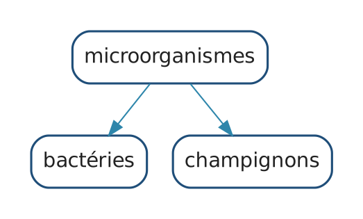

# Le compostage en appartement : principe, matériel et erreurs à éviter

## Principe du compostage

Le compostage est une technique qui combine le déchets de l'habitat avec des microorganismes pour réduire la quantité de déchets et les rendre plus nutritifs. Les microorganismes, comme les bactéries et les champignons, sont capables de convertir les déchets en compost, un produit naturel et nutritif qui peut être utilisé comme nourriture pour les animaux et les plantes.

1. microorganismes
2. bactéries
3. champignons

| microorganismes | bactéries | champignons |
|---|---|---|
| 1 | microorganismes |  |
| 2 | bactéries |  |
| 3 | champignons |  |

*>{{1}}*

> Les microorganismes, comme les bactéries et les champignons, sont capables de convertir les déchets en compost, un produit naturel et nutritif qui peut être utilisé comme nourriture pour les animaux et les plantes.

> ⚠️ aucune icône pour « compostage »

*>{{1}}*

> ⚠️ aucune icône pour « compostage »

## Le compostage en appartement : principe, matériel et erreurs à éviter

Le compostage est un processus qui transforme les déchets de l'extérieur en un sol riche en acides aminés. Il est généralement réalisé en appartement, où on utilise des matériaux tels que le sable, le verre et le bois pour créer un environnement propice à la transformation.

1. matériel de compostage
2. matériel de compostage
3. matériel de compostage
4. matériel de compostage
5. matériel de compostage
6. matériel de compostage
7. matériel de compostage
8. matériel de compostage
9. matériel de compostage
10. matériel de compostage
11. matériel de compostage
12. matériel de compostage

| matériel de compostage | matériel de compostage | matériel de compostage | matériel de compostage | matériel de compostage | matériel de compostage | matériel de compostage | matériel de compostage |
|---|---|---|---|---|---|---|---|
| 1 | matériel de compostage | matériel de compostage | matériel de compostage | matériel de compostage | matériel de compostage | matériel de compostage | matériel de compostage |
| 2 | matériel de compostage | matériel de compostage | matériel de compostage | matériel de compostage | matériel de compostage | matériel de compostage | matériel de compostage |
| 3 | matériel de compostage | matériel de compostage | matériel de compostage | matériel de compostage | matériel de compostage | matériel de compostage | matériel de compostage |
| 4 | matériel de compostage | matériel de compostage | matériel de compostage | matériel de compostage | matériel de compostage | matériel de compostage | matériel de compostage |
| 5 | matériel de compostage | matériel de compostage | matériel de compostage | matériel de compostage | matériel de compostage | matériel de compostage | matériel de compostage |
| 6 | matériel de compostage | matériel de compostage | matériel de compostage | matériel de compostage | matériel de compostage | matériel de compostage | matériel de compostage |
| 7 | matériel de compostage | matériel de compostage | matériel de compostage | matériel de compostage | matériel de compostage | matériel de compostage | matériel de compostage |
| 8 | matériel de compostage | matériel de compostage | matériel de compostage | matériel de compostage | matériel de compostage | matériel de compostage | matériel de compostage |
| 9 | matériel de compostage | matériel de compostage | matériel de compostage | matériel de compostage | matériel de compostage | matériel de compostage | matériel de compostage |
| 10 | matériel de compostage | matériel de compostage | matériel de compostage | matériel de compostage | matériel de compostage | matériel de compostage | matériel de compostage |
| 11 | matériel de compostage | matériel de compostage | matériel de compostage | matériel de compostage | matériel de compostage | matériel de compostage | matériel de compostage |
| 12 | matériel de compostage | matériel de compostage | matériel de compostage | matériel de compostage | matériel de compostage | matériel de compostage | matériel de compostage |

*>{{12}}</schema>}, {*

## Éviter les erreurs

L'erreur d'utilisation du matériel de compostage peut être le manque de déchets, la mauvaise concentration des matériaux et l'absence de temps suffisants pour le compostage.
