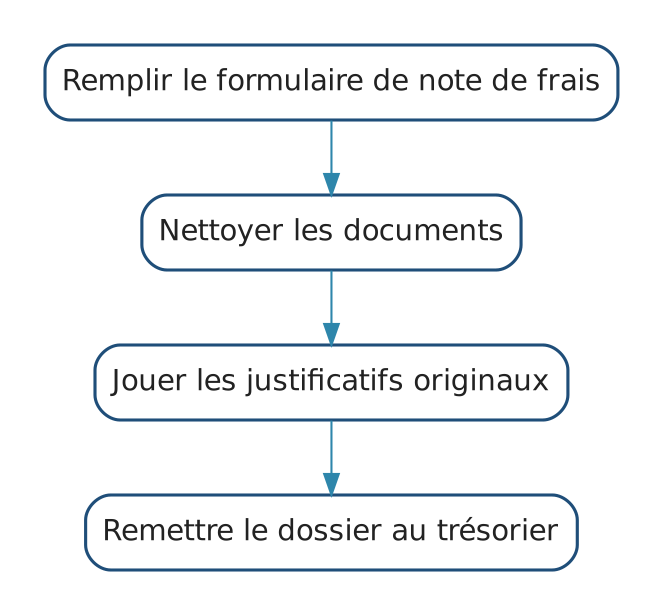

# Procédure de remboursement des notes de frais Solidarité Numérique

## Étapes

- Remplir le formulaire de note de frais
- Nettoyer les documents
- Jouer les justificatifs originaux
- Remettre le dossier au trésorier

## Schéma des étapes

