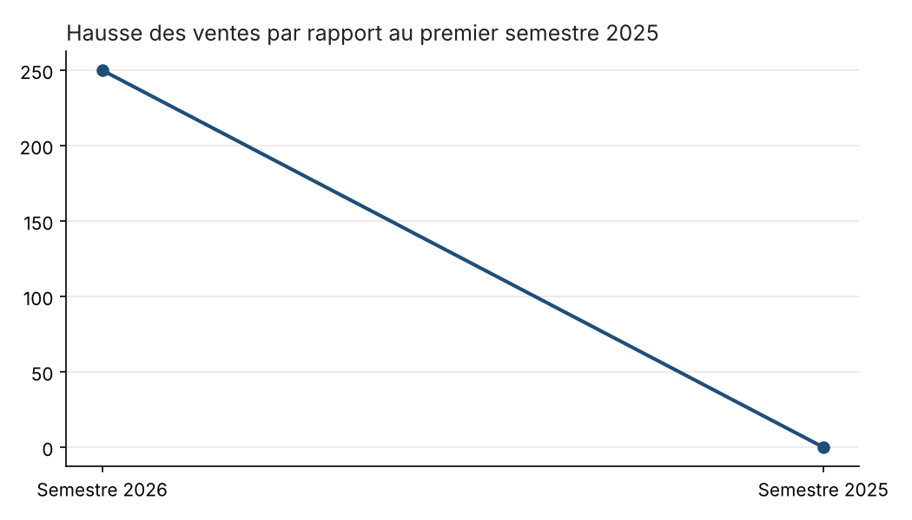

# Bilan commercial de la boulangerie Le Fournil pour le premier semestre 2026

## Chiffres d'affaires mensuels

Chiffre d'affaires mensuel : janvier 38 200 euros, février 35 900 euros, mars 41 300 euros, avril 43 800 euros, mai 46 100 euros, juin 44 700 euros.

| Mois | Chiffre d'affaires |
|---|---|
| Janvier | 38 200 € |
| Février | 35 900 € |
| Mars | 41 300 € |
| Avril | 43 800 € |
| Mai | 46 100 € |
| Juin | 44 700 € |

## Total du semestre

Le total du semestre atteint 250 000 euros, en hausse de 7 % par rapport au premier semestre 2025.

*Hausse de 7 %*
