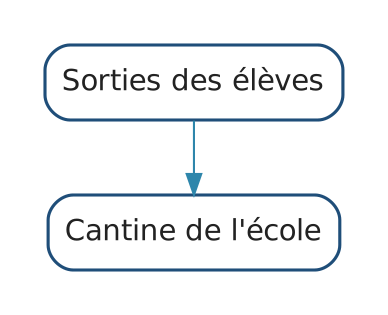
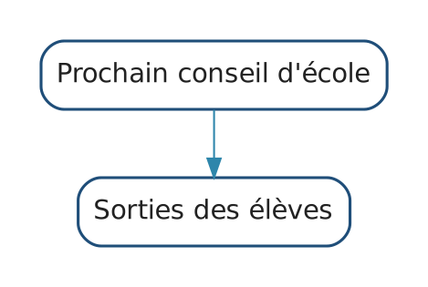

# Compte rendu de réunion du conseil d'école de l'école élémentaire Jean-Moulin

## Informations générales

Le compte rendu du conseil d'école de l'école élémentaire Jean-Moulin a été présenté le 14 octobre 2026.

| Personne | Rôle |
|---|---|
| Mme Diallo | Directrice |
| 9 enseignants | Enseignants |
| 6 représentants des parents | Parents |
| Adjoint au maire chargé de l'éducation | Invité |

## Effectifs et travaux

L'école élémentaire Jean-Moulin accueille 212 élèves répartis en 9 classes, soit une moyenne de 23,5 élèves par classe.

| Travail | Budget |
|---|---|
| Refaire la cour | 45 000 euros |

## Sorties des élèves

Les élèves du CM2 partiront en classe de mer à Saint-Malo du 11 au 15 mai, le coût par élève est de 280 euros, dont 120 euros pris en charge par la coopérative.

## Sécurité à l'école

Un exercice d'évacuation a eu lieu le 2 octobre et s'est terminé en 3 minutes 40.

## Prochain conseil d'école

Le prochain conseil d'école se tiendra le 10 février 2027.

