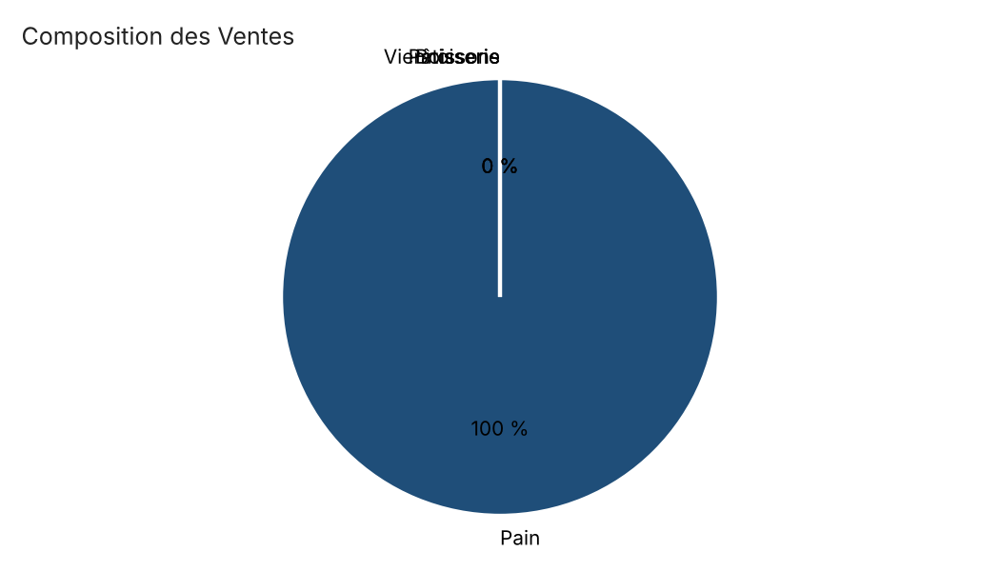
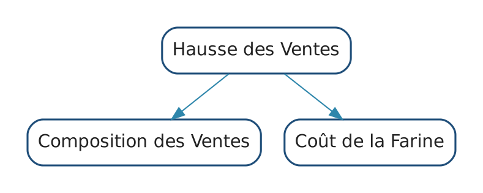
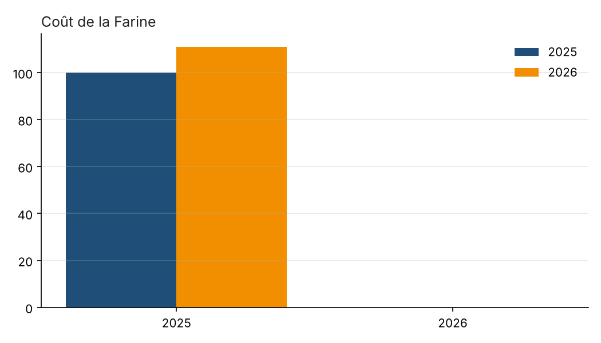

# Rapport des Ventes de la Boulangerie Le Fournil pour le Premier Semestre 2026

## Bilan Commercial

Le bilan commercial de la boulangerie Le Fournil pour le premier semestre 2026 est présenté avec des chiffres précis.

| Mois | Ventes |
|---|---|
| Janvier | 38 200 euros |
| Février | 35 900 euros |
| Mars | 41 300 euros |
| Avril | 43 800 euros |
| Mai | 46 100 euros |
| Juin | 44 700 euros |

> Le total des ventes pour le premier semestre 2026 est de 250 000 euros.

## Composition des Ventes

- Le pain représente 52 % des ventes
- la viennoiserie 28 %
- la pâtisserie 15 %
- les boissons 5 %

## Hausse des Ventes

La hausse des ventes pour le premier semestre 2026 est de 7 % par rapport au premier semestre 2025.

## Coût de la Farine

Le coût de la farine a augmenté de 11 % sur un an.

## Évolution des Ventes en Mai

La hausse des ventes en mai est due au lancement d'une gamme de sandwichs le midi.
