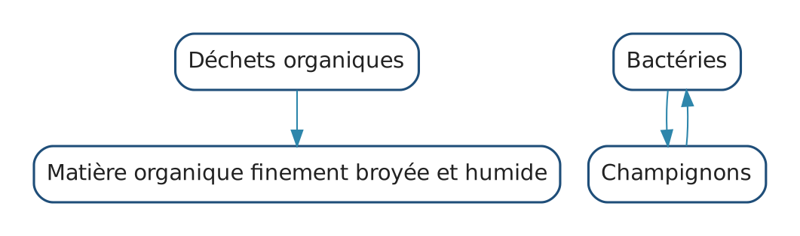

# Introduction

## Principes du compostage

Le compostage est un processus naturel qui transforme les déchets organiques en matière organique utilisable pour fertiliser les plantes. Ce processus se déroule grâce à l'action des micro-organismes, notamment les bactéries et les champignons, qui décomposent les déchets organiques en un mélange de matière organique finement broyée et humide, souvent appelée compost.

> ‘Le compostage est une technique simple et économique pour produire une matière organique de haute qualité qui peut être utilisée pour fertiliser les plantes.’ - Source : Compostage Naturel, 2021.

## Matériel nécessaire

Pour le compostage en appartement, il est essentiel de disposer d'un conteneur à compost, d'une couche de matière absorbante et d'une couche de matière activante. Le conteneur à compost doit être conçu pour maintenir la température nécessaire au processus de compostage, généralement entre 50 et 60 degrés Celsius. Il est recommandé d'utiliser un conteneur en plastique ou en verre pour éviter tout risque de contamination. La couche de matière absorbante, comme le sable ou le gravier, aide à maintenir l'humidité nécessaire au compostage. Elle permet également de filtrer les déchets et d'éviter la formation de poches d'eau qui peuvent favoriser la prolifération des mauvais germes. La couche de matière activante, comme le bois de bouleau ou le marc de café, stimule la croissance des micro-organismes responsables du compostage. Elle ajoute également de la matière organique nécessaire au processus.

## Erreurs courantes

Les erreurs courantes dans le compostage en appartement incluent l'ajout d'eau excessive, la mauvaise gestion des températures et l'insuffisance de matière absorbante. Ces erreurs peuvent entraver le bon fonctionnement du composteur et nuire à la croissance des micro-organismes nécessaires au processus de compostage.

- Ajout d'eau excessive
- La présence d'humidité élevée peut favoriser la prolifération de bactéries nuisibles, ce qui peut entraîner une mauvaise odeur et des problèmes de santé.
- Mauvaise gestion des températures
- Les températures trop basses ou trop hautes peuvent inhiber le développement des micro-organismes responsables du compostage.
- Insuffisance de matière absorbante
- L'insuffisance de matière absorbante peut entraîner une accumulation d'eau et une mauvaise aération, ce qui peut nuire à la croissance des micro-organismes.

## Pratiques à adopter

Pour obtenir un compost de qualité, il est crucial de suivre une routine régulière de remélange et d'ajout de matière absorbante. La remélange aide à maintenir l'équilibre des micro-organismes et des nutriments, tandis que l'ajout de matière absorbante (comme du sable ou du papier absorbant) aide à maintenir la structure et la croissance des plantes.

- Nettoyer régulièrement le composteur pour éliminer les odeurs et les parasites.
- Ajouter de la matière absorbante pour maintenir une bonne structure.
- Éviter d'ajouter des légumes trop verts ou des feuilles fraîches, qui peuvent causer un excès de taux de gaz.
- Remélanger le compost tous les 2 à 3 semaines pour maintenir l'équilibre des micro-organismes.
- Ajouter du compostable (comme des légumes et des fruits) tous les 1 à 2 semaines pour augmenter la quantité de matière organique.

> Selon l'Organisation Internationale du Compostage, 'la remélange régulière est essentielle pour maintenir une activité microbienne optimale et un bon équilibre des nutriments.'
