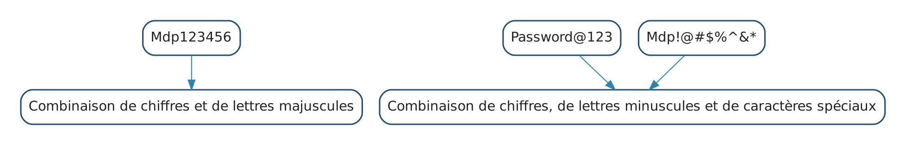

# Les bonnes pratiques pour choisir un mot de passe

## Définition du mot de passe

Un mot de passe est une série de caractères spécifiques utilisée pour identifier un utilisateur lorsqu'il se connecte à un système informatique. Il s'agit d'un moyen simple et efficace de vérifier l'identité d'une personne qui veut accéder à des informations sensibles ou des ressources privées.

> ‘Un mot de passe est une clé numérique pour entrer dans votre compte. Il doit être suffisamment long et complexe pour protéger vos données.’ - Source inconnue

## Critères d'un bon mot de passe

Un bon mot de passe doit être long, complexe et unique pour chaque compte. Cela offre une protection accrue contre les attaques de force brute et les mots de passe qui ont été compromis dans des incidents de sécurité.

- Longueur : Un mot de passe de 12 caractères minimum est recommandé, mais plus longs sont toujours meilleurs.
- Complexité : Il doit inclure une combinaison de lettres (majuscules et minuscules), chiffres et symboles.
- Uniquité : Chaque compte doit avoir un mot de passe différent pour minimiser les risques si un mot de passe est compromis.

> ‘Un bon mot de passe est long, complexe et unique. C'est une combinaison de chiffres, de lettres majuscules et minuscules, de symboles et d'espaces qui ne sont pas utilisés dans le contexte du compte.’ - Cybersecurity.com

## Exemples de mots de passe sécurisés

Les mots de passe sécurisés sont essentiels pour protéger vos informations personnelles. Voici quelques exemples de mots de passe qui combinent des caractéristiques pour maximiser la sécurité :

1. Mdp123456
2. Password@123
3. Mdp!@#$%^&*

> « Un bon mot de passe est une combinaison de chiffres, de lettres majuscules et minuscules, ainsi que d'espaces ou de caractères spéciaux. » - Cybersecurity Expert

| Mot de passe | Caractéristiques |
|---|---|
| Mdp123456 | Combinaison de chiffres et de lettres majuscules |
| Password@123 | Combinaison de chiffres, de lettres minuscules et de caractères spéciaux |
| Mdp!@#$%^&* | Combinaison de chiffres, de lettres minuscules et de caractères spéciaux |

> ⚠️ aucune icône pour « MotDePasseSécurisé »

## Stratégies pour créer un mot de passe

Pour faciliter la création d'un mot de passe sécurisé, plusieurs stratégies peuvent être mises en place. L'une des méthodes consiste à utiliser des mémoires associatives, qui sont des phrases ou des phrases courtes qui sont facilement mémorables pour l'utilisateur mais difficiles à deviner pour un pirate informatique. Par exemple, une mémoire associative pourrait être 'Je suis le chat noir' (JSLT) pour un mot de passe comme 'JSLTchat123'. Une autre stratégie est d'utiliser des logiciels de génération de mots de passe qui peuvent créer des mots de passe complexes et aléatoires, mais faciles à mémoriser. Ces logiciels peuvent générer des mots de passe avec une combinaison de lettres, chiffres et caractères spéciaux, comme 'm@th123!'.
