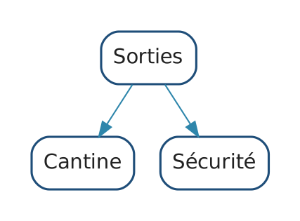
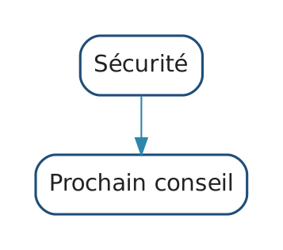

# Compte rendu de réunion du conseil d'école

## Présents et Effectifs

Le conseil d'école a eu lieu le 14 octobre 2026. Présents : la directrice Mme Diallo, 9 enseignants, 6 représentants des parents et l'adjoint au maire chargé de l'éducation. Effectifs : l'école Jean-Moulin accueille 212 élèves répartis en 9 classes, soit 23,5 élèves par classe en moyenne.

## Travaux

La mairie a voté 45 000 euros pour refaire la cour. Les travaux auront lieu pendant les vacances de février.

## Sorties

Les CM2 partiront en classe de mer à Saint-Malo du 11 au 15 mai. Le coût par élève est de 280 euros, dont 120 euros pris en charge par la coopérative.

## Cantine

Les parents signalent des repas froids. La mairie va installer deux armoires chauffantes avant décembre.

## Sécurité

Un exercice d'évacuation a eu lieu le 2 octobre et s'est terminé en 3 minutes 40.

## Prochain conseil

Le prochain conseil aura lieu le 10 février 2027.
