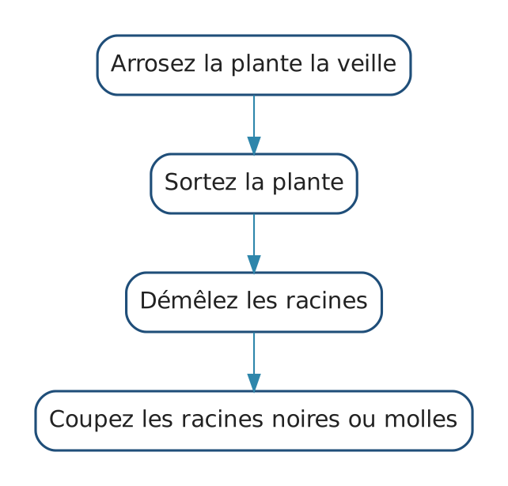

# Rempotage d'une plante d'intérieur

## Préparation du Pot

Pour rempoter une plante, commencez par choisir un pot dont le diamètre est plus grand que celui de l'ancien de 2 à 4 centimètres. Le meilleur moment pour effectuer ce rempotage est au printemps, entre mars et mai.

## Étapes du Rempotage

- Placez au fond du pot une couche de billes d'argile d'environ 3 centimètres pour le drainage.
- Sortez la plante, démêlez les racines qui tournent en rond et coupez celles qui sont noires ou molles.
- Posez la plante, complétez avec du terreau neuf en tassant légèrement, en laissant 2 centimètres sous le bord du pot.
- Arrosez abondamment puis laissez la plante à l'ombre pendant une semaine.

## Conseils

N'apportez pas d'engrais pendant un mois : le terreau neuf en contient déjà.

> Le rempotage est une occasion idéale pour nettoyer les racines et vérifier leur santé.

## Vérification

> ⚠️ aucune icône pour « vérification »
