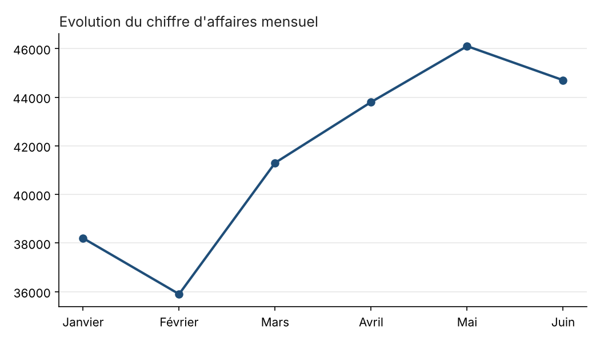

# Bilan commercial de la boulangerie Le Fournil pour le premier semestre 2026

## Chiffres d'affaires mensuels

Les chiffres d'affaires mensuels de la boulangerie Le Fournil pour le premier semestre 2026 sont les suivants : janvier 38 200 euros, février 35 900 euros, mars 41 300 euros, avril 43 800 euros, mai 46 100 euros et juin 44 700 euros.

| Mois | Chiffre d'affaires (€) |
|---|---|
| Janvier | 38 200 |
| Février | 35 900 |
| Mars | 41 300 |
| Avril | 43 800 |
| Mai | 46 100 |
| Juin | 44 700 |

## Total du semestre

Le total des ventes pour le premier semestre 2026 est de 250 000 euros, soit une augmentation de 7 % par rapport au premier semestre 2025.

## Composition des ventes

- Le pain représente 52 % des ventes
- La viennoiserie 28 %
- La pâtisserie 15 %
- Les boissons 5 %

La hausse de mai s'explique par le lancement d'une gamme de sandwichs le midi.

## Coût de la farine

Le coût de la farine a augmenté de 11 % sur un an.
