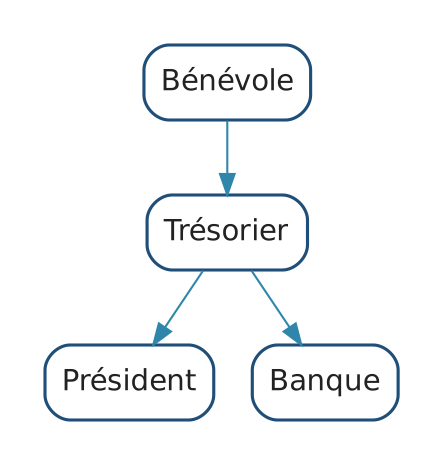

# Procédure de Remboursement des Notes de Frais

## Étapes

Le bénévole remplit le formulaire de note de frais et y joint les justificatifs originaux.

Il remet le dossier au trésorier.

Le trésorier vérifie que la dépense a été autorisée par le bureau et que les justificatifs sont complets.

Si le dossier est incomplet, il le renvoie au bénévole avec la liste des pièces manquantes.

Si le dossier est complet, le président signe l'ordre de paiement.

Le trésorier effectue alors le virement sous 15 jours.

## Remboursements

1. Frais kilométriques : 0,32 euro par kilomètre

1. Repas : 20 euros maximum

## Informations

> Le bénévole remplit le formulaire de note de frais et y joint les justificatifs originaux.

> ⚠️ aucune icône pour « formulaires »
