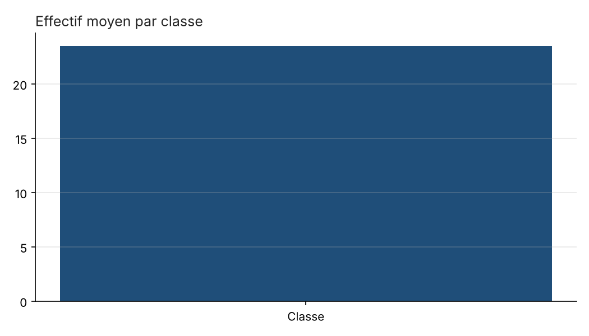
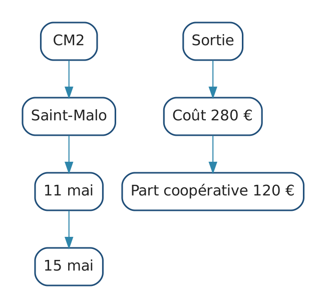
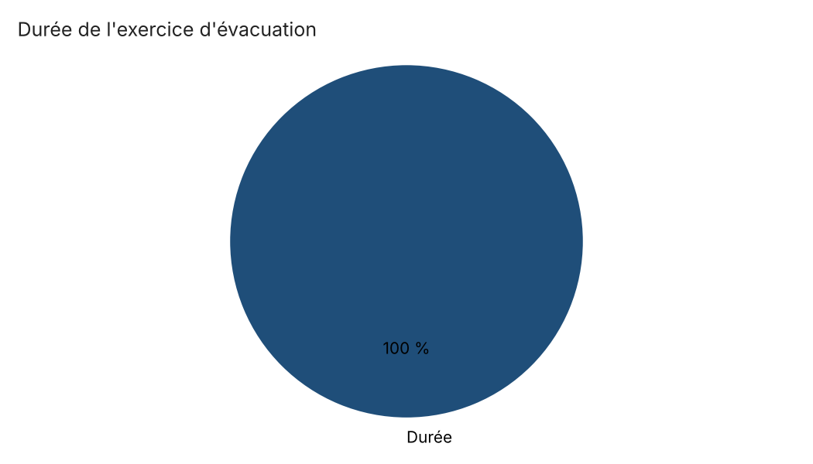
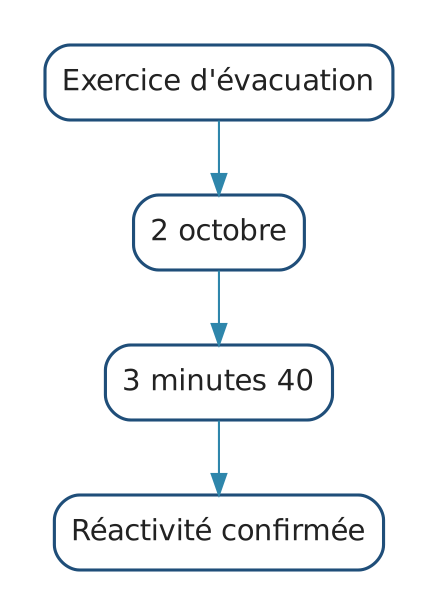

# Compte rendu de réunion

## Participants et représentants

La réunion a été présidée par Mme Diallo, la directrice de l'école. Présents également, il y a 9 enseignants et 6 représentants des parents. L'adjoint au maire chargé de l'éducation est également présent.

| Catégorie | Nombre |
|---|---|
| Enseignants | 9 |
| Représentants des parents | 6 |
| Adjoints au maire | 1 |

## Structure de l'école et effectifs

L'école accueille un total de 212 élèves répartis en 9 classes. En moyenne, chaque classe compte 23,5 élèves.

> L'école est structurée en 9 classes, avec un effectif total de 212 élèves.

## Travaux et améliorations

- Les travaux de rénovation de la cour seront réalisés pendant les vacances de février.
- La mairie va installer deux armoires chauffantes avant décembre.
- La mairie a voté 45 000 euros pour refaire la cour.

| Projet | Date | Coût |
|---|---|---|
| Rénovation de la cour | Vacances de février | 45 000 € |
| Installation armoires chauffantes | Avant décembre | Non spécifié |

## Activités et sorties scolaires

Les élèves de CM2 partiront en classe de mer à Saint-Malo du 11 au 15 mai. Le coût par élève des sorties est de 280 euros, dont 120 euros sont pris en charge par la coopérative.

| Élément | Valeur |
|---|---|
| Coût total par élève | 280 € |
| Part prise en charge par la coopérative | 120 € |
| Durée de la sortie | 11 au 15 mai |

> ⚠️ aucune icône pour « sortie scolaire »

## Sécurité et gestion des risques

Un exercice d'évacuation a eu lieu le 2 octobre. L'exercice s'est terminé en 3 minutes 40, ce qui indique une bonne réactivité du personnel.

> L'exercice d'évacuation a duré 3 minutes 40 et s'est terminé efficacement.

## Prochaines réunions

Le prochain conseil de l'école aura lieu le 10 février 2027.

| Événement | Date |
|---|---|
| Prochain conseil | 10 février 2027 |

