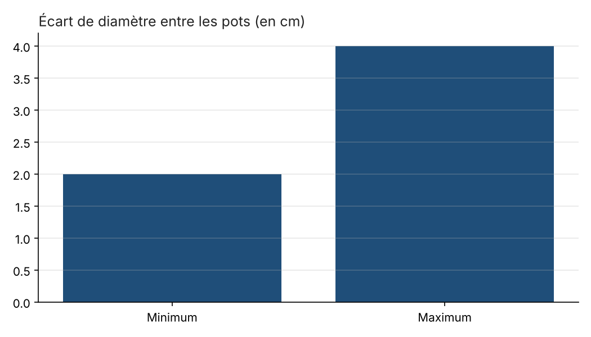
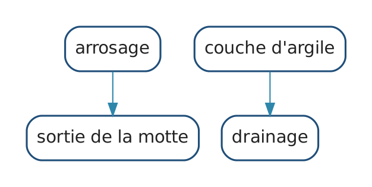
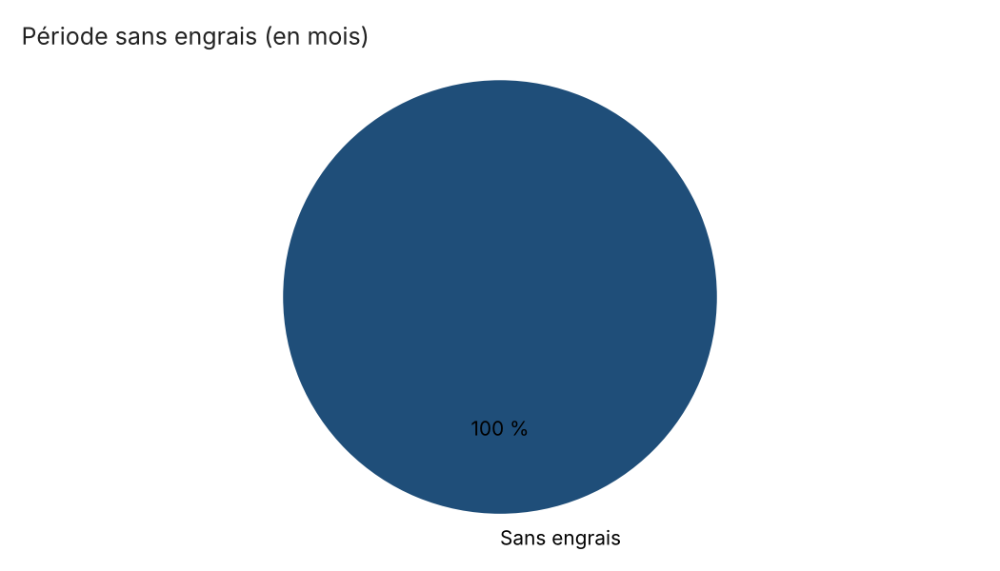

# Comment rempoter une plante d'intérieur : guide pratique

## Choisir le bon pot

Le diamètre du nouveau pot doit être supérieur à celui de l'ancien de 2 à 4 centimètres pour permettre une croissance saine sans surcharger la plante.

> ⚠️ aucune icône pour « diamètre »

## Meilleur moment pour rempoter

Le printemps, entre mars et mai, est le meilleur moment car les plantes sont en période de croissance active.

| Mois | Période |
|---|---|
| Mars | Début du printemps |
| Mai | Fin du printemps |

> ⚠️ aucune icône pour « printemps »

## Préparation avant le rempotage

- Arrosez la plante la veille pour faciliter l'extirpation de la motte.
- Placez une couche de billes d'argile d'environ 3 centimètres au fond du pot pour améliorer le drainage.

> ⚠️ aucune icône pour « drainage »

## Réaliser le rempotage

Démêlez les racines en les dégageant des tours, coupez celles qui sont noires ou molles pour éviter les maladies.

| Action | Description |
|---|---|
| Sortir la plante | Démêler les racines |
| Couper les racines | Éliminer celles noires ou molles |

> ⚠️ aucune icône pour « racines »

## Après rempotage et soins

Posez la plante dans le nouveau pot, complétez avec du terreau neuf en tassant légèrement, en laissant 2 centimètres sous le bord du pot. Arrosez abondamment puis placez-la à l'ombre pendant une semaine.

> N'apportez pas d'engrais pendant un mois : le terreau neuf en contient déjà suffisamment.

> ⚠️ aucune icône pour « soins »
