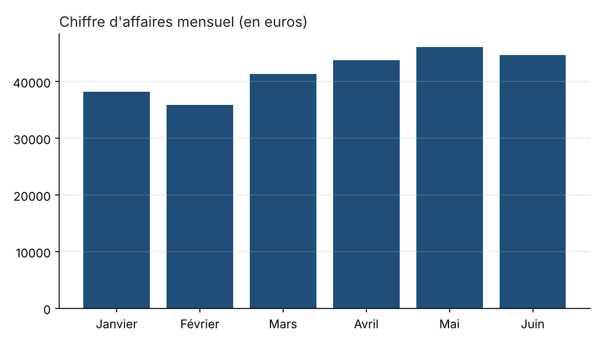
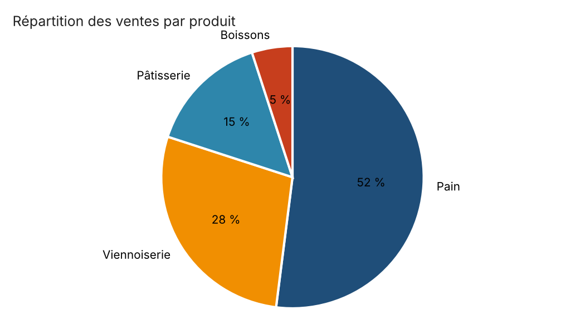
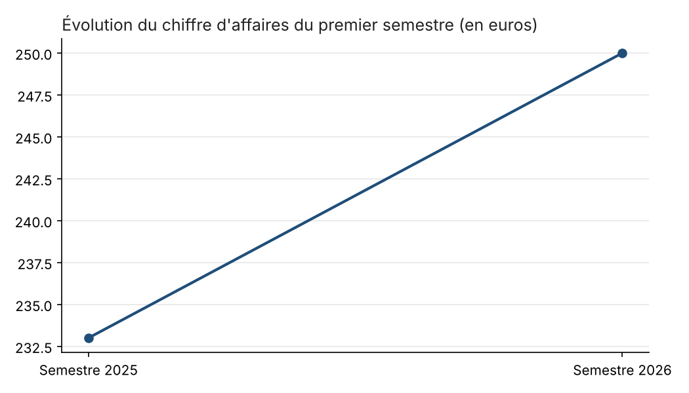
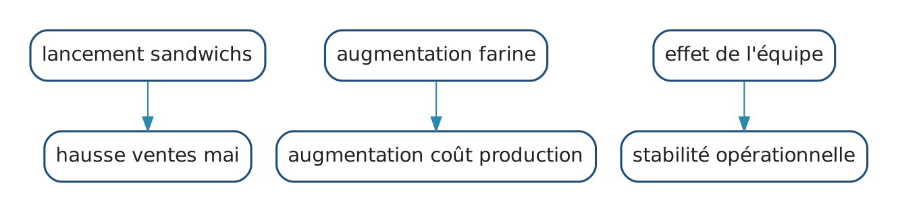

# Rapport des ventes de la boulangerie Le Fournil

## Chiffres d'affaires mensuels

Les ventes mensuelles de la boulangerie Le Fournil montrent une évolution progressive au fil des mois, avec un pic en mai. Les chiffres d'affaires s'élèvent à 38 200 euros en janvier, 35 900 euros en février, 41 300 euros en mars, 43 800 euros en avril, 46 100 euros en mai et 44 700 euros en juin.

| Mois | Chiffre d'affaires (en euros) |
|---|---|
| Janvier | 38 200 |
| Février | 35 900 |
| Mars | 41 300 |
| Avril | 43 800 |
| Mai | 46 100 |
| Juin | 44 700 |

> La hausse de ventes en mai s'explique par le lancement d'une gamme de sandwichs le midi.

## Répartition des produits vendus

La répartition des ventes par catégorie de produit montre que le pain constitue la part la plus importante, suivie de la viennoiserie, puis de la pâtisserie et des boissons.

| Produit | Part des ventes (%) |
|---|---|
| Pain | 52 |
| Viennoiserie | 28 |
| Pâtisserie | 15 |
| Boissons | 5 |

> Le pain représente 52 % des ventes.

## Évolution du chiffre d'affaires par rapport à l'année précédente

Le total du chiffre d'affaires du premier semestre 2026 s'élève à 250 000 euros, en hausse de 7 % par rapport au premier semestre 2025.

| Indicateur | Valeur |
|---|---|
| Total du semestre (2026) | 250 000 euros |
| Hausse par rapport à 2025 | 7 % |

> Le total du semestre 2026 est en hausse de 7 % par rapport au premier semestre 2025.

## Facteurs d'influence sur les ventes

Plusieurs facteurs influencent la performance commerciale, notamment le lancement de nouveaux produits et l'augmentation des coûts de production.

- Lancement d'une gamme de sandwichs en mai
- Augmentation du coût de la farine de 11 % sur un an
- Équipe composée de 7 salariés depuis avril

