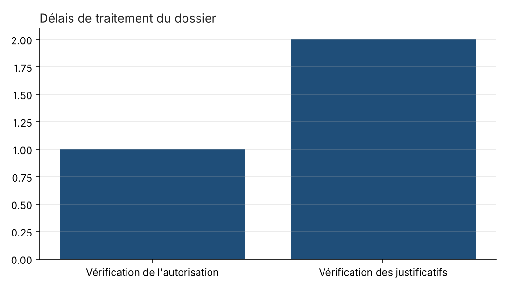
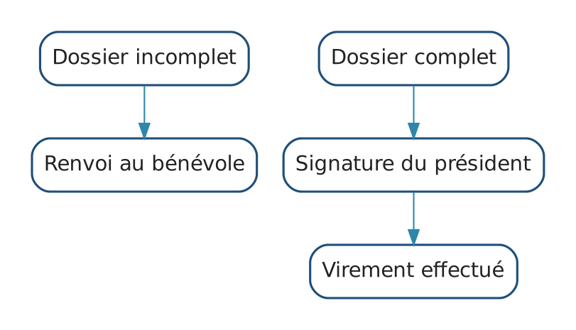
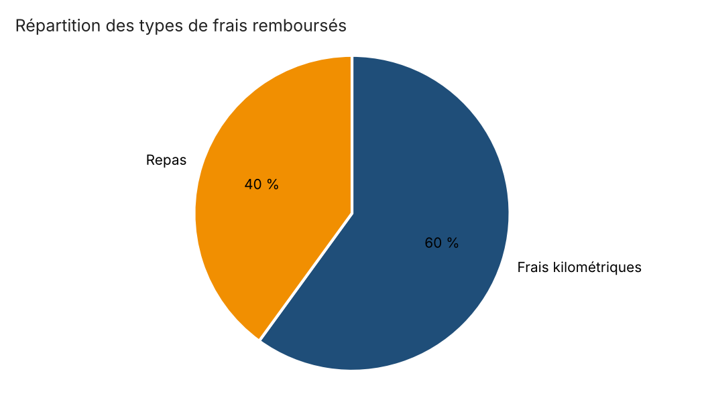
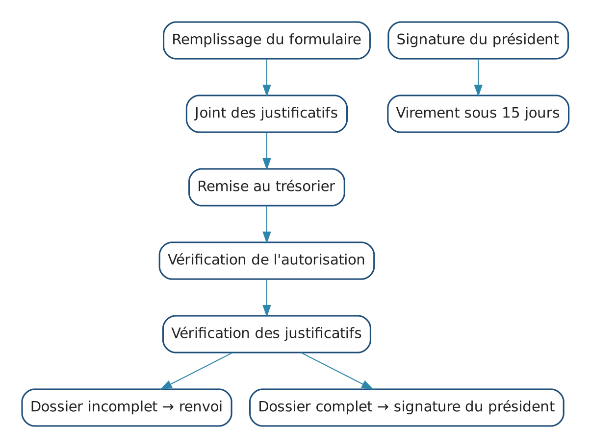

# Procédure de remboursement des frais pour bénévoles

## Remplissage du formulaire et accompagnement des justificatifs

Le bénévole doit remplir le formulaire de note de frais dans les 30 jours suivant la dépense. Il y joint les justificatifs originaux afin de garantir la traçabilité et la validité des frais.

| Élément | Délai ou montant |
|---|---|
| Formulaire de note de frais | Rempli dans les 30 jours |
| Justificatifs originaux | Joint au formulaire |

## Validation du dossier par le trésorier

- Le trésorier vérifie que la dépense a été autorisée par le bureau.
- Il contrôle la complétude des justificatifs.

> Le trésorier assure la conformité du dossier aux règles internes de gestion des frais.

## Traitement du dossier incomplet ou complet

Si le dossier est incomplet, le trésorier le renvoie au bénévole avec une liste des pièces manquantes. En revanche, si le dossier est complet, le président signe l'ordre de paiement.

## Effectuation du virement et remboursements spécifiques

Une fois le dossier validé, le trésorier effectue le virement sous 15 jours. Les frais kilométriques sont remboursés à 0,32 euro par kilomètre, et les repas sont remboursés jusqu'à 20 euros.

| Type de frais | Montant ou taux |
|---|---|
| Frais kilométriques | 0,32 € par kilomètre |
| Repas | jusqu'à 20 € |

## Chronologie des étapes clés

