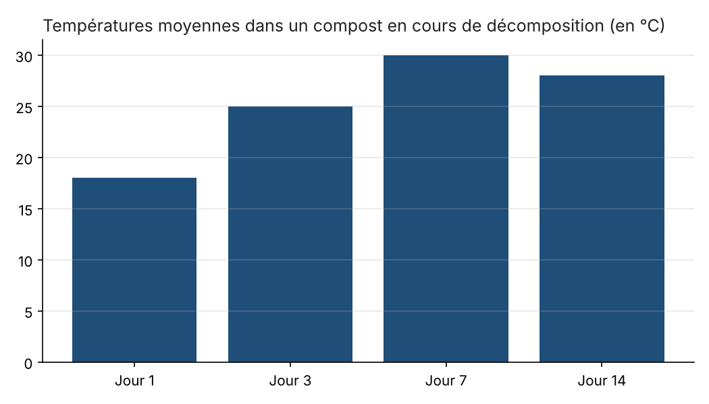
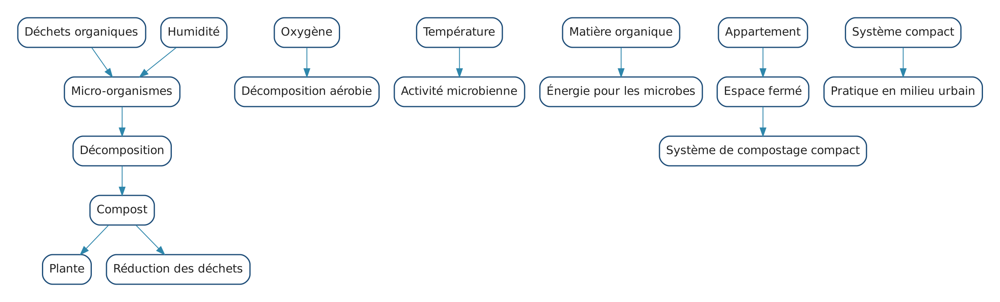
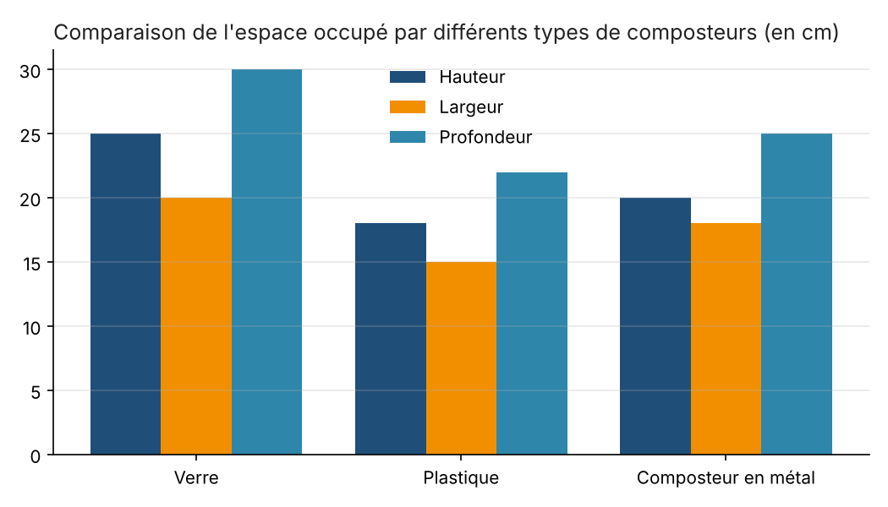
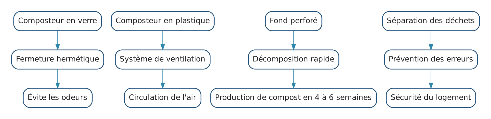
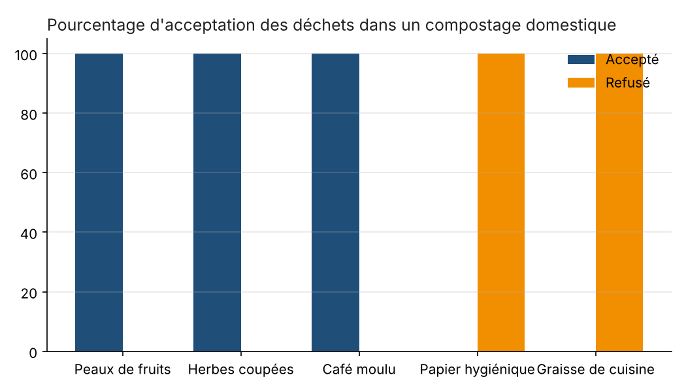
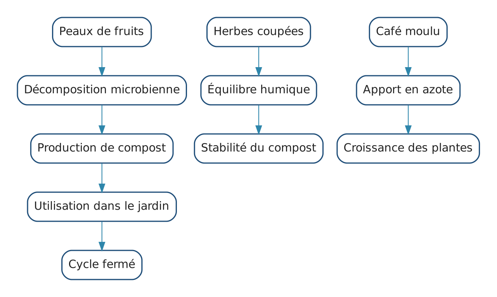
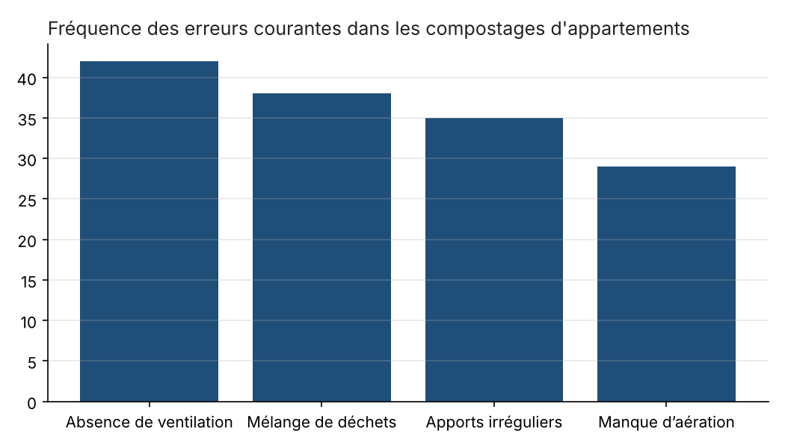
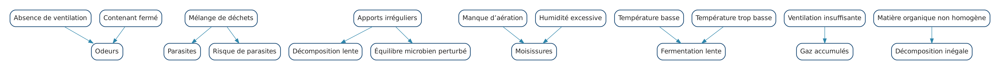

# Le compostage en appartement : principes, matériel et erreurs à éviter

## Le compostage en appartement : principes, matériel et erreurs à éviter

Le compostage repose sur un processus naturel de décomposition des matières organiques, où des micro-organismes tels que les bactéries, les champignons et les protozoaires agissent en symbiose pour transformer les déchets en un sol riche en nutriments. Ce processus s'appuie sur une combinaison d'humidité, de température, d'oxygène et de matière organique, permettant de produire un compost utilisable dans les jardins ou pour la culture de plantes.

- La décomposition est un processus biologique contrôlé par des micro-organismes.
- Les conditions optimales incluent une bonne aération, une humidité modérée et une température entre 15 °C et 30 °C.
- Le compostage permet de réduire la quantité de déchets envoyés aux décharges.
- Il contribue à la circularité des ressources en recyclant les matières organiques.
- Ce processus peut être réalisé dans un espace restreint, comme un appartement, grâce à des systèmes adaptés.

| Facteur | Rôle dans le compostage |
|---|---|
| Oxygène | Permet une décomposition aérobie efficace et rapide. |
| Humidité | Facilite la croissance des micro-organismes, mais doit être équilibrée. |
| Température | Indique l'activité biologique : une température élevée signale une décomposition active. |
| Matière organique | Fournit l'énergie nécessaire à la croissance des micro-organismes. |

> « Le compostage est une forme de gestion durable des déchets organiques, qui permet non seulement de réduire les émissions de gaz à effet de serre, mais aussi d’alimenter les plantes avec un nutriment naturel. »

> ⚠️ aucune icône pour « décomposition »

## Matériel nécessaire

Pour pratiquer efficacement le compostage en appartement, il est essentiel de choisir un matériel adapté aux contraintes d'espace et à la sécurité des conditions de stockage. Un composteur conçu pour les petits espaces, comme un modèle en verre ou en plastique, permet non seulement une gestion simple des déchets organiques, mais aussi une préservation de l'hygiène et de la propreté dans un environnement urbain.

- Composteur en verre : durable, facile à nettoyer et à identifier les étapes de compostage.
- Composteur en plastique : léger, compact et souvent doté d’un système de fermeture hermétique pour éviter les odeurs.
- Système de fermeture hermétique : indispensable pour limiter les émissions d’odeurs et prévenir les infiltrations d’air ou de poussière.
- Conteneur avec un fond en matière perforée : favorise la circulation de l’air nécessaire à la décomposition.
- Séparateur de déchets intégré (optionnel) : permet de trier les matières organiques avant le compostage.

| Type de composteur | Avantages | Inconvénients |
|---|---|---|
| Verre | Résistant, facile à nettoyer, visibilité du processus | Plus lourd, coûteux |
| Plastique | Léger, compact, fermeture hermétique | Moins durable, risque de dégradation avec le temps |

> « Un composteur bien choisi est la clé pour réussir le compostage sans odeurs ni désordre dans un appartement. »

> ⚠️ aucune icône pour « espace »

## Déchets acceptés

Le compostage en appartement repose sur la transformation naturelle de déchets organiques en compost riche en nutriments. Seuls les restes biologiques peuvent être intégrés au processus, tels que les peaux de fruits et légumes, les herbes coupées, les feuilles mortes ou le café moulu. Ces matières sont riches en matière organique et favorisent la croissance microbienne nécessaire à la décomposition.

- Peaux de fruits et légumes
- Feuilles d'herbes coupées
- Restes de plantes vivantes
- Café moulu (sans gouttes de café)
- Fleurs séchées ou en fleurs

| Déchet | Accepté ? | Explication |
|---|---|---|
| Peau de citron | Oui | Riche en matière organique, facilement décomposée |
| Graisse de cuisine | Non | Favorise la putréfaction et attire les rongeurs |
| Papier hygiénique | Non | Ne se décompose pas et contient des résidus chimiques |
| Café moulu | Oui | Excellent apport en azote, idéal pour le compost |
| Résidus de viande | Non | Contient des matières protéiques qui peuvent produire des odeurs |

> Les déchets organiques sont la base du compostage : sans eux, le processus ne peut s'effectuer efficacement.

*Accepté = vert | Refusé = rouge*

> ⚠️ aucune icône pour « organique »

## Le compostage en appartement : principes, matériel et erreurs à éviter

Le compostage en appartement peut sembler une solution écologique simple, mais il est sujet à plusieurs erreurs courantes qui nuisent à l'efficacité du processus. L'absence de ventilation, le mélange de déchets incompatibles ou l'oubli de la régularité des apports peuvent ralentir la décomposition, provoquer des odeurs désagréables ou favoriser la prolifération de parasites.

- Ne pas assurer une ventilation adéquate du compost, ce qui entraîne une accumulation de gaz et des odeurs fortes.
- Mélanger des déchets non compatibles comme les restes de viande, de produits chimiques ou de plastique.
- Oublier de répartir régulièrement les apports de matière organique, ce qui perturbe l'équilibre microbien.
- Ne pas surveiller la température du compost, ce qui peut favoriser la croissance de moisissures ou de parasites.
- Utiliser un contenant fermé sans ouverture pour ventilation, ce qui empêche l'oxygénation nécessaire au bon fonctionnement du compost.

| Erreur | Conséquence | Solution recommandée |
|---|---|---|
| Absence de ventilation | Odeurs, accumulation de gaz | Installer une ouverture ventilée ou un couvercle à ouverture contrôlée |
| Mélange de déchets non compatibles | Décomposition lente, risque de parasites | Séparer les déchets en deux catégories : verts et noirs |
| Apports irréguliers | Équilibre microbien perturbé | Ajouter des matières organiques tous les 3 à 4 jours |
| Température trop basse | Moisissures, fermentation lente | Aérer régulièrement et maintenir un apport de matière humide |
| Contenant fermé sans ventilation | Manque d’oxygène, odeurs | Utiliser un composteur avec ouverture ventilée |

> « Le compostage réussi repose sur un équilibre précis entre humidité, oxygène et température. Une erreur simple peut déclencher une cascade de problèmes. »

