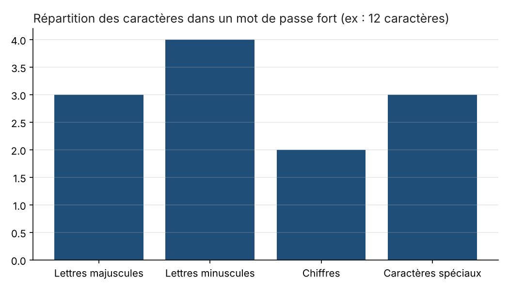
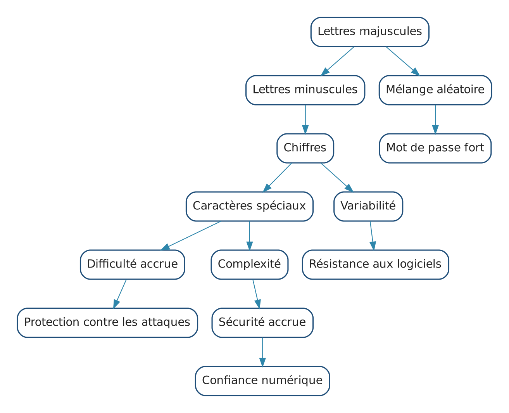
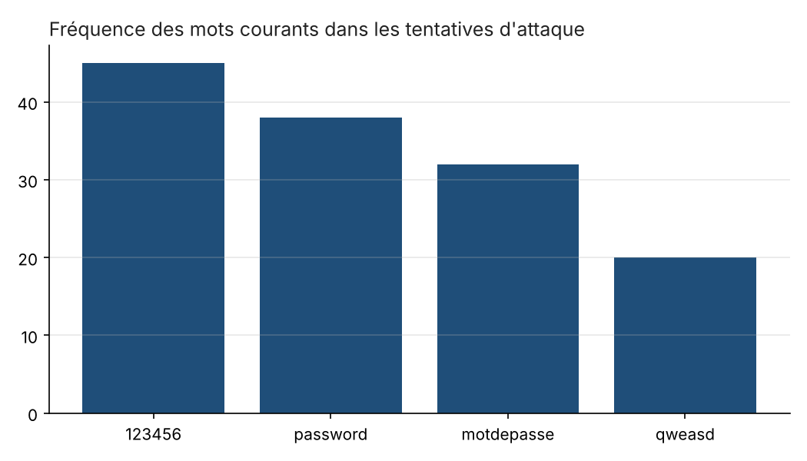
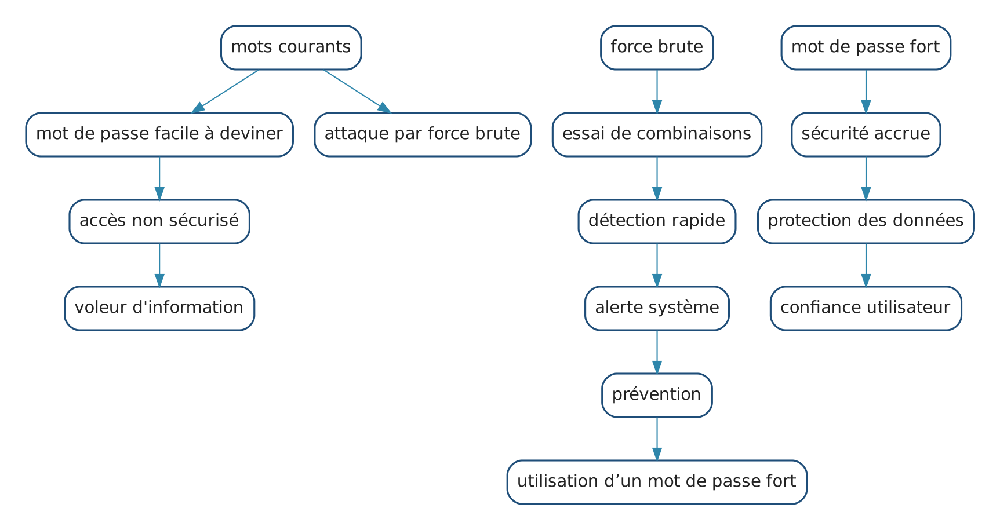
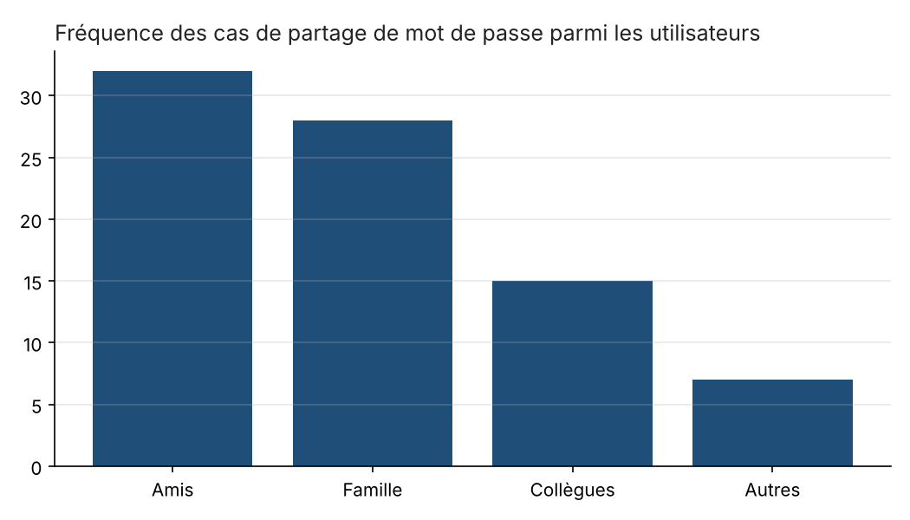
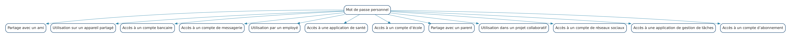
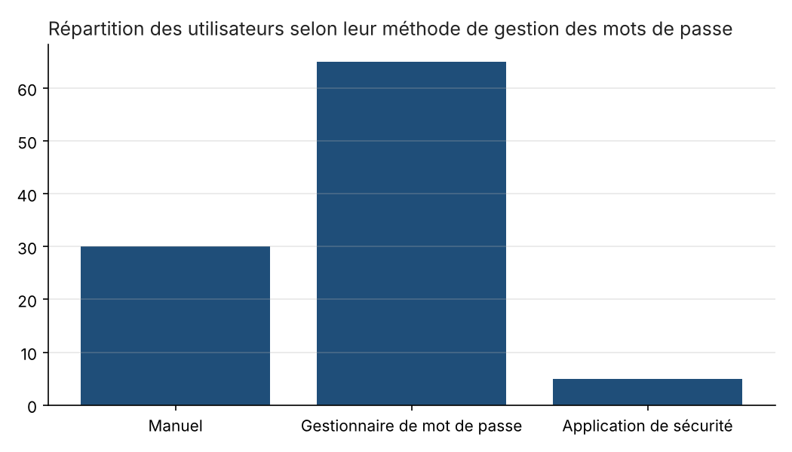
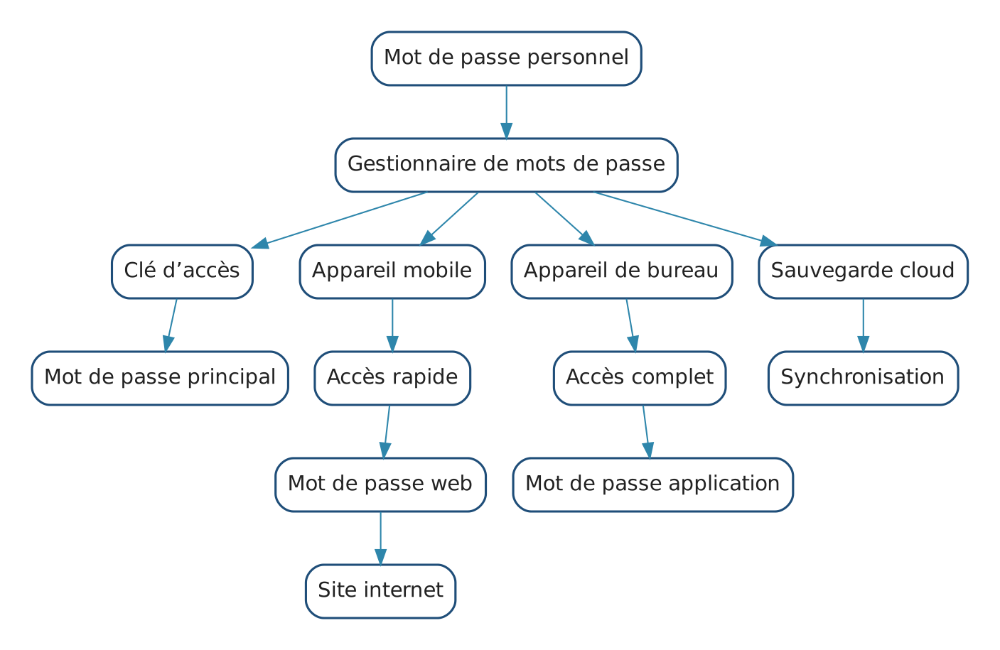

# Les bonnes pratiques pour choisir un mot de passe

## Utiliser une combinaison forte

Un mot de passe fort est un mot ou une suite de caractères difficile à deviner ou à casser par des logiciels. Il doit inclure au moins une combinaison de lettres majuscules (A-Z), minuscules (a-z), des chiffres (0-9) et des caractères spéciaux (comme !, @, #, $, %). Cela rend le mot de passe plus résistant aux attaques automatiques, comme les tentatives de mots courants ou les algorithmes de force brute.

- Inclure au moins 8 caractères
- Mélanger des lettres majuscules et minuscules
- Ajouter des chiffres (0 à 9)
- Utiliser un caractère spécial (ex : @, #, $)

| Type de caractère | Exemple | Pourquoi c’est utile |
|---|---|---|
| Lettres majuscules | Myp@ssw0rd | Ajoute de la variété et rend le mot de passe plus complexe |
| Chiffres | P@ssw0rd2024 | Empêche les attaques basées sur des mots simples |
| Caractères spéciaux | Tr0ub1e!2025 | Augmente la difficulté pour les logiciels de déduction |

> Un mot de passe fort n’est pas un mot facile à retenir, mais il est difficile à deviner ou à briser par un ordinateur.

> ⚠️ aucune icône pour « complexité »

## Éviter les mots courants

Utiliser des mots courants comme "motdepasse", "123456" ou "password" est une erreur grave. Ces combinaisons sont très fréquentes et figées dans les bases de données des cybercriminels. En effet, des études montrent que plus de 80 % des tentatives de piratage commencent par des mots simples ou des séries numériques. Cela rend le mot de passe facilement devinable, même sans attaque sophistiquée.

- motdepasse
- password
- 123456
- lettre
- jean
- monpasse

| Mots courants | Pourquoi ils sont dangereux | Exemple d'usage |
|---|---|---|
| motdepasse | Très fréquent dans les attaques | Utilisé par des personnes qui pensent que c’est simple |
| 123456 | Le mot le plus souvent deviné | Séquence numérique facile à deviner |
| password | Trop prévisible | Utilisé comme exemple dans les cours de sécurité |

> « Un mot de passe basique comme "123456" est aussi facile à deviner qu’un code de sécurité sur un vélo. » — Expert en cybersécurité, 2023

> ⚠️ aucune icône pour « prévisibilité »

## Ne pas partager son mot de passe

Un mot de passe ne doit jamais être partagé, même avec des proches comme un conjoint, un parent ou un ami. Cela peut sembler étrange, mais chaque compte en ligne — qu’il s’agisse d’un compte bancaire, de messagerie ou de réseaux sociaux — doit avoir un mot de passe unique et sécurisé. Si vous partagez votre mot de passe, vous exposez directement vos données à des risques comme le vol d’identité, les accès non autorisés ou des usurpations d’identité.

- Ne jamais donner votre mot de passe à un ami, un parent ou un collègue
- Éviter de le dire par téléphone ou en face à face
- Ne pas le mettre dans un message ou un courriel
- Ne pas le partager même pour aider quelqu’un à se connecter à un compte

| Situation | Action à éviter | Conseil alternatif |
|---|---|---|
| Un ami veut accéder à ton compte de messagerie | Dire le mot de passe | Utiliser un service de partage sécurisé ou un lien de connexion temporaire |
| Ton conjoint veut voir tes achats en ligne | Partager ton mot de passe | Créer un compte séparé avec une authentification par code |

> « Un mot de passe partagé est comme une clé mise dans la main d’un inconnu : il peut ouvrir n’importe quelle porte. »

## Utiliser un gestionnaire de mots de passe

Un gestionnaire de mots de passe est un outil numérique qui stocke tous vos mots de passe de manière sécurisée. Il vous permet de générer des combinaisons fortes, de les sauvegarder sans avoir à les écrire à la main, et d’accéder facilement à chaque mot de passe depuis un seul endroit. Cela réduit le risque de perdre ou de révéler un mot de passe, surtout si vous utilisez des phrases complexes ou des mots aléatoires.

- Génère automatiquement des mots de passe forts et aléatoires
- Stocke tous vos mots de passe dans un endroit sécurisé (souvent crypté)
- Permet d’accéder à chaque mot de passe avec une clé unique (comme un mot de passe principal)
- Fonctionne sur plusieurs appareils (ordinateur, téléphone, tablette)
- Offre des alertes pour les mots de passe expirés ou vulnérables

| Fonctionnalité | Avantage |
|---|---|
| Génération automatique | Évite d’utiliser des mots faciles à deviner |
| Synchronisation multi-appareils | Accès partout sans perdre vos données |
| Cryptage fort | Protège vos données contre les accès non autorisés |

> « Un mot de passe fort n’est pas une garantie de sécurité. Un gestionnaire de mots de passe est le véritable allié pour gérer efficacement et en toute sécurité tous vos identifiants. »

