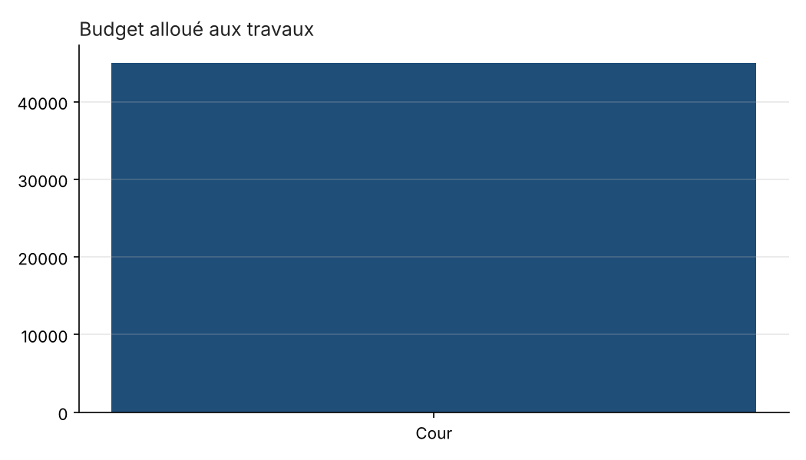

# Compte rendu de la réunion du conseil d'école du 14 octobre 2026

*Réunion du 14 octobre 2026 – École élémentaire Jean-Moulin*

## Présence et effectifs

La réunion a été présidée par la directrice Mme Diallo, avec la participation de 9 enseignants, 6 représentants des parents et de l'adjoint au maire chargé de l'éducation.

| Élément | Valeur |
|---|---|
| Nombre total d'élèves | 212 |
| Nombre de classes | 9 |
| Moyenne par classe | 23,5 |

> L'école accueille 212 élèves répartis en 9 classes, soit 23,5 élèves par classe en moyenne.

## Travaux de rénovation

La mairie a approuvé un budget de 45 000 euros pour la rénovation de la cour de l'école, qui sera réalisée pendant les vacances de février.

> ⚠️ aucune icône pour « renovation »

## Sorties scolaires

Les élèves de CM2 partiront en classe de mer à Saint-Malo du 11 au 15 mai, avec un coût de 280 euros par élève.

| Élément | Valeur |
|---|---|
| Durée de la sortie | du 11 au 15 mai |
| Coût par élève | 280 euros |
| Partie financée par la coopérative | 120 euros |

- Sortie en classe de mer
- Destination : Saint-Malo
- Période : 11 au 15 mai
- Coût total par élève : 280 €
- Soutien financier : 120 € de la coopérative
