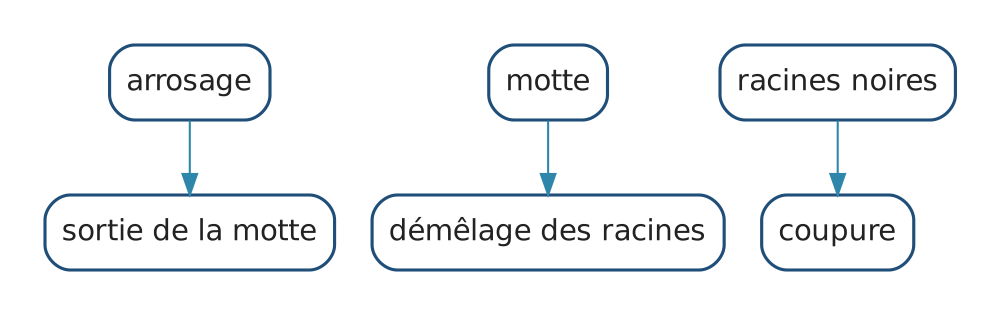
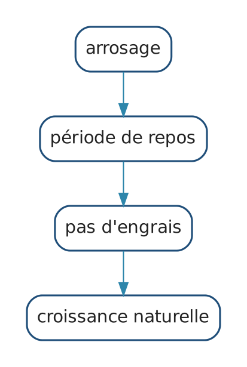

# Comment rempoter une plante d'intérieur : guide pratique

## Choisir le bon pot

Le nouveau pot doit être plus large que l'ancien de 2 à 4 centimètres pour donner de l'espace aux racines sans surcharger la plante.

> Un pot trop petit empêche la croissance ; un pot trop grand peut retenir trop d'eau et provoquer des maladies.

| Taille du pot | Avantage |
|---|---|
| 2 à 4 cm de plus | Espacement suffisant pour les racines |
| Moins de 2 cm | Risque de surcharge |
| Plus de 4 cm | Risk d'excès d'eau |

## Meilleur moment pour rempoter

Le printemps, entre mars et mai, est idéal car c'est la période de croissance active de la plante.

## Préparation avant le rempotage

- Arrosez la plante la veille pour faciliter l'extraction de la motte
- Placez une couche de billes d'argile (3 cm) au fond du pot pour éviter l'accumulation d'eau

## Réaliser le rempotage

Démêlez les racines en cercle, coupez celles qui sont noires ou molles, puis posez la plante dans le nouveau pot.

| Action | Objectif |
|---|---|
| Démêler les racines | Améliorer la croissance |
| Couper les racines noires | Éviter les maladies |
| Tasser le terreau | Stabiliser la plante |

> ⚠️ aucune icône pour « hygiène »

## Après rempotage

Arrosez abondamment pour réhydrater le terreau, puis laissez la plante à l'ombre pendant une semaine. N'apportez pas d'engrais pendant un mois car le nouveau terreau en contient déjà.

> ⚠️ aucune icône pour « repos »
