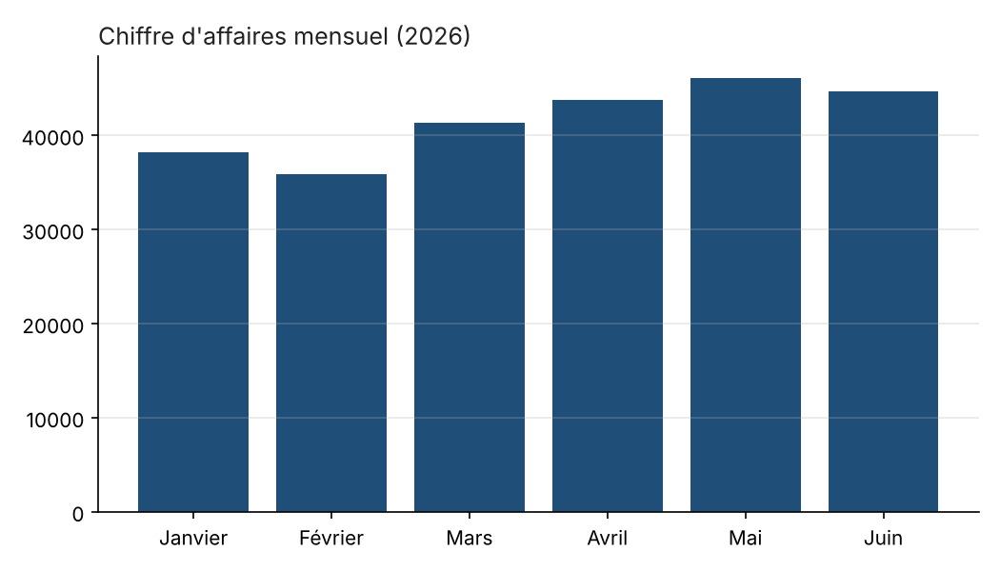
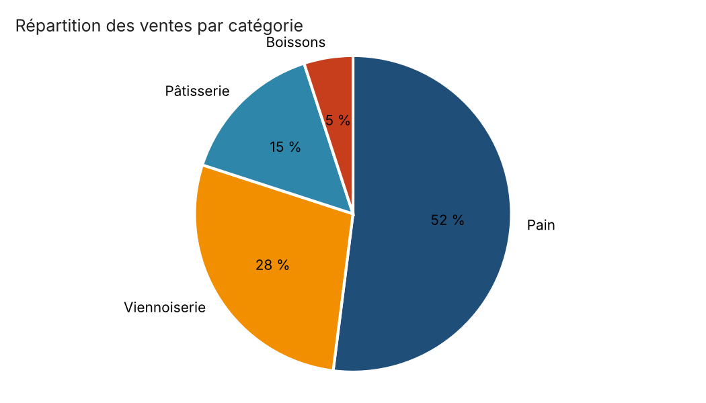
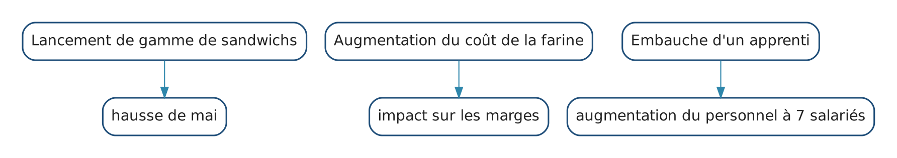
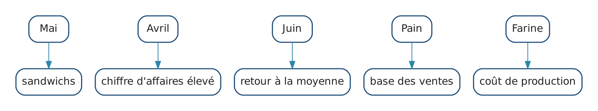

# Bilan commercial de la boulangerie Le Fournil - Première moitié 2026

## Chiffres d'affaires mensuels

Les ventes mensuelles ont montré une progression régulière au cours du premier semestre 2026, avec une augmentation progressive du chiffre d'affaires, atteignant un pic en avril avant une légère baisse en juin.

| Mois | Chiffre d'affaires (en euros) |
|---|---|
| Janvier | 38 200 |
| Février | 35 900 |
| Mars | 41 300 |
| Avril | 43 800 |
| Mai | 46 100 |
| Juin | 44 700 |

> Le total du semestre atteint 250 000 euros, en hausse de 7 % par rapport au premier semestre 2025.

## Répartition des produits vendus

La structure des ventes est dominée par le pain, qui représente la moitié des ventes, suivie de la viennoiserie et de la pâtisserie.

| Catégorie | Part des ventes (%) |
|---|---|
| Pain | 52 |
| Viennoiserie | 28 |
| Pâtisserie | 15 |
| Boissons | 5 |

> La hausse de mai s'explique par le lancement d'une gamme de sandwichs le midi.

## Facteurs clés de performance

L'évolution du chiffre d'affaires est influencée par des facteurs internes comme la mise en place de nouveaux produits et des variations des coûts de production.

1. Lancement de gamme de sandwichs en mai
2. Augmentation du coût de la farine de 11 % sur un an
3. Embauche d'un apprenti en avril

## Analyse des tendances

Le semestre s'est caractérisé par une progression continue du chiffre d'affaires, avec un pic en mai, qui a été soutenu par la diversification des offres alimentaires.

