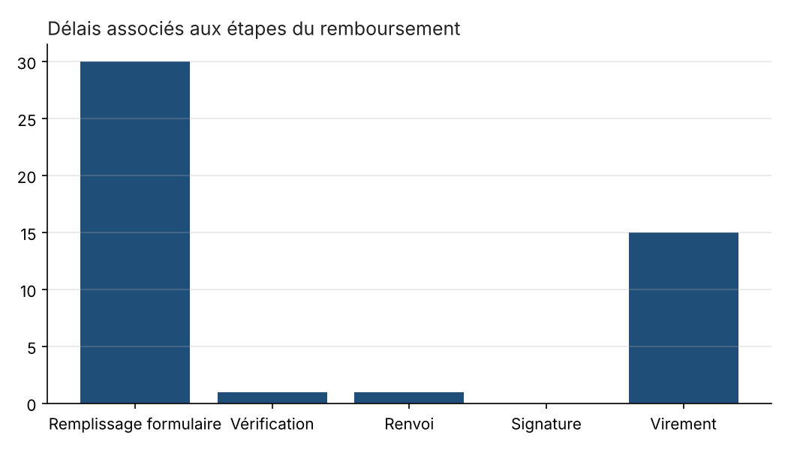
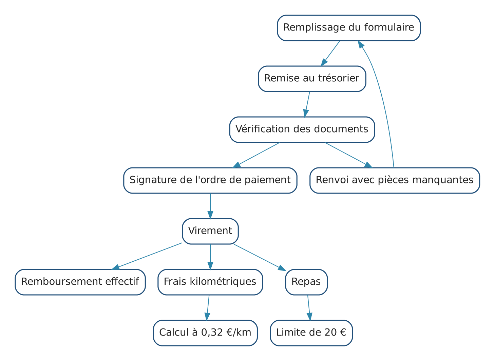
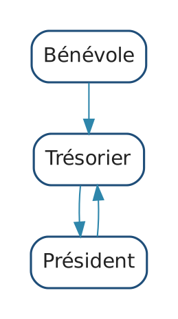

# Procédure de remboursement des notes de frais de l'association Solidarité Numérique

## Étapes du processus de remboursement

La procédure de remboursement des notes de frais suit un parcours structuré, allant de la saisie du formulaire jusqu'à l'effectuation du virement. Chaque étape est clairement définie et doit être respectée pour garantir la validité et la rapidité du traitement.

1. Le bénévole remplit le formulaire de note de frais dans les 30 jours suivant la dépense.
2. Il y joint les justificatifs originaux.
3. Le dossier est remis au trésorier.
4. Le trésorier vérifie l'autorisation du bureau et la complétude des justificatifs.
5. Si le dossier est incomplet, il est renvoyé au bénévole avec une liste des pièces manquantes.
6. Si le dossier est complet, le président signe l'ordre de paiement.
7. Le trésorier effectue le virement sous 15 jours.

| Étape | Responsable | Délai ou condition |
|---|---|---|
| Remplissage du formulaire | Bénévole | Dans les 30 jours suivant la dépense |
| Vérification du dossier | Trésorier | Sur validation de l'autorisation et des justificatifs |
| Renvoi du dossier | Trésorier | Si pièces manquantes |
| Signature de l'ordre de paiement | Président | Seulement si le dossier est complet |
| Virement | Trésorier | Sous 15 jours après validation |

> Les frais kilométriques sont remboursés à 0,32 euro par kilomètre.

## Conditions de remboursement

Les remboursés sont soumis à des seuils précis selon la nature des dépenses.

| Type de dépense | Montant maximal ou taux |
|---|---|
| Frais kilométriques | 0,32 € par kilomètre |
| Repas | 20 € maximum |

> Les repas sont remboursés dans la limite de 20 euros.

## Rôle des responsables

Chaque acteur du processus a un rôle précis et fonctionnellement défini.

| Fonction | Responsabilités |
|---|---|
| Bénévole | Remplir le formulaire et joindre les justificatifs |
| Trésorier | Vérifier l'autorisation, contrôler la complétude, renvoyer ou procéder au virement |
| Président | Signer l'ordre de paiement lorsqu'il est complet |

## Contrôles et validations

Des vérifications strictes sont mises en place pour assurer la conformité des dossiers.

1. Vérification de l'autorisation du bureau
2. Contrôle de la complétude des justificatifs
3. Renvoi avec liste des pièces manquantes

> Si le dossier est incomplet, il est renvoyé au bénévole avec la liste des pièces manquantes.
